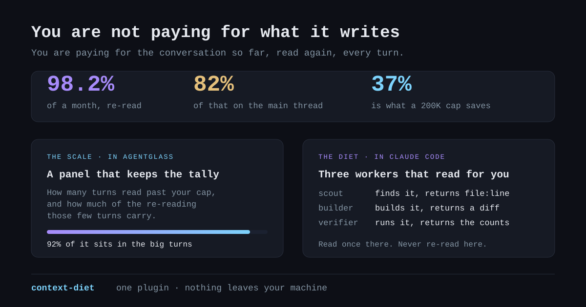

# context-diet

One plugin, two halves: a **scale** that shows where your tokens go, and a
**diet** that moves the reading off the thread that pays for it.

Almost nothing an agent charges you for is what it writes. It is the
conversation so far, read again, on every single turn — 98% of a month of real
tokens on one machine, with the main thread carrying 82% of it. So this does
not make anything cheaper to run. It changes **where the reading happens**: a
file read in a worker is read once and thrown away, and the same file read on
the expensive thread is re-read for the rest of the session.



## The diet — in Claude Code

| | model | what it owns |
|---|---|---|
| `scout` | Haiku | Finding things. Returns `file:line`, never advice. |
| `builder` | Sonnet | One bounded contract end to end, in a worktree of its own. Returns a diff summary and what it ran. |
| `verifier` | Haiku | Running the checks. Returns the counts, never the log. |

One question, one repository: a grep and two reads put **5,099 bytes** into
the thread; `scout` answered it in **621**. A test suite printed **3,538**;
`verifier` returned **71**.

A short note is added at the start of every session so the habit does not
depend on remembering it. The full discipline loads as the `context-diet`
skill when the work earns it.

```
/plugin marketplace add SirAllap/context-diet
/plugin install context-diet@context-diet
```

## The scale — in agentglass

A *Context ledger* panel with the tally nobody keeps: not how many turns are
large, but **how much of all the re-reading those turns carry** — when a tenth
of them carry most of it, the habit worth changing is a small one. It also
shows what the workers in this session read, which is a fact rather than a
promise: that much never entered the thread, so it is never re-read.

```
Settings → Plugins → Install → https://github.com/SirAllap/context-diet
```

Scope `read`. It never notifies, types into a session, sends `/clear`,
releases a gate or starts a process.

## What it actually changes

**Which model a delegation lands on — a fact.** The three agents pin their
model; without a pin, delegated work inherits the session default, which is
the expensive one where nobody set it. Measured on a real machine: **206
subagent turns on Haiku after installing, against Sonnet and Opus before**,
nothing else changed. A test fails if a rename ever drops a pin.

**How often the main thread delegates — a tendency.** Given a multi-file
change it delegated the reading in **8 of 12 runs with the plugin and 3 of 12
without** (Δ +0.42, no-plugin baseline). It makes delegating the normal move;
it does not make it certain.

Two results that flatter nobody, from the same suite: a one-word typo is never
delegated either way, and `builder`'s contract discipline is unchanged,
because Claude already had it. Full table, including two cases whose graders
were wrong and are marked unmeasured: [`evals/RESULTS.md`](evals/RESULTS.md).

## What leaves your machine

Nothing, and it writes nothing of yours. Everything it keeps lives in
`~/.local/share/context-diet/`; delete that folder and it has forgotten
everything. It does not touch your settings, hooks or status line — an install
that rewrites your configuration is not an install, it is a change of mind you
did not make. The workers are ordinary Claude Code subagents: no third-party
provider, no proxy, no other vendor's key.

## What it cannot do

It does not shrink a context that is already large, only stop one growing —
the lever for what is already there is starting fresh between unrelated tasks,
and no plugin can press it for you. It does not rescue a vague contract: a
worker given an unclear brief returns code that is wrong, and reviewing that
costs more than the delegation saved. The scale saves nothing by itself; it is
an instrument, and ignored it is worth zero. And below a handful of turns none
of it pays — the round trip is then the expensive part.

## Develop

```
python3 -B -m unittest discover tests
agentglass-plugin validate .
claude plugin eval . --trust-plugin --allow-tools Bash Task Edit Write -j 8 --runs 12
```

`-B` is not decoration: two edits a second apart that leave the file the same
length pass Python's mtime-and-size check, and the run then executes the
previous bytecode while the source says something else.
